<h1 align="center">Seedy</h1>

<p align="center">
  A Jellyfin client for your browser, your Android phone and your Android TV.
</p>

<p align="center">
  <a href="https://github.com/Arkmind/seedy/releases/latest"></a>
  <a href="https://jellyfin.org"></a>
  <a href="LICENSE"></a>
</p>

Seedy comes in two parts. The web app replaces Jellyfin's own and installs as a plugin, so there's nothing else to
host: add the plugin, restart, and your server address opens Seedy. The Android app runs on phones and on Android TV
(one APK for both), and works with any Jellyfin 12 server, with or without the plugin.

Both are built around the same few ideas. The home screen learns what each person actually watches. Requests through
[Seerr](https://github.com/seerr-team/seerr) sit right next to your library instead of in another tab. And the player
tries hard not to make your server convert anything it doesn't have to.

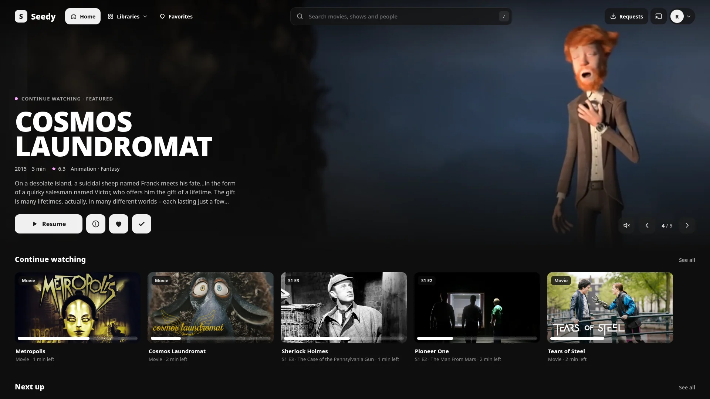

<p align="center">
  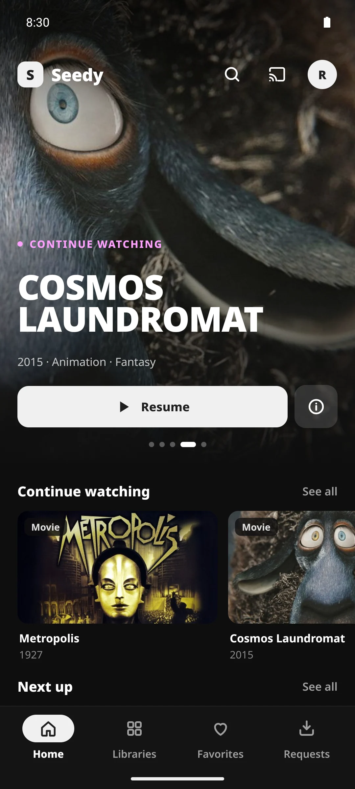
  &nbsp;
  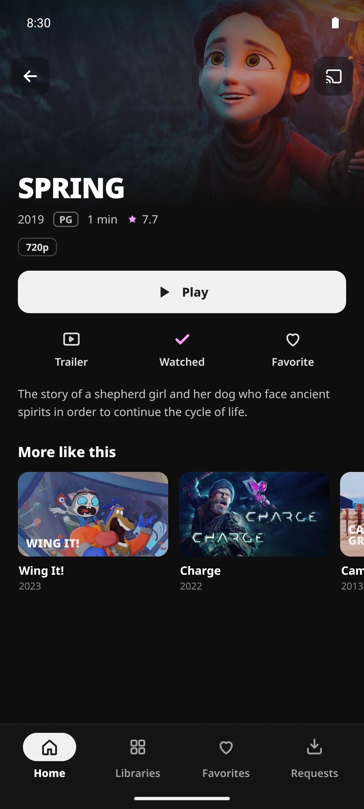
  &nbsp;
  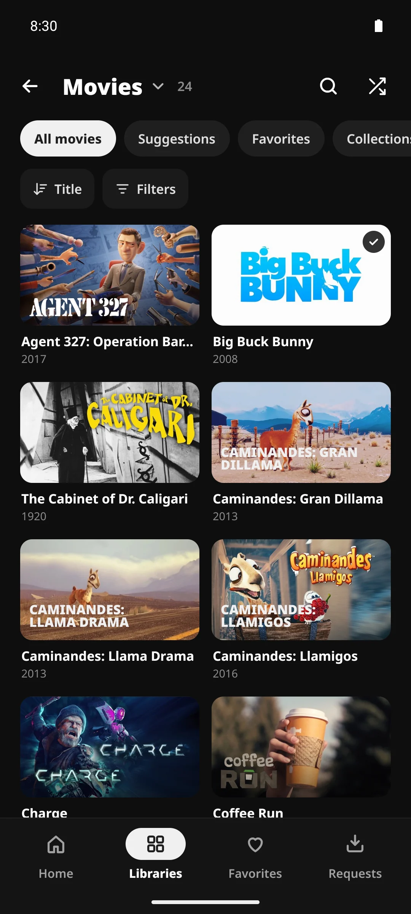
  &nbsp;
  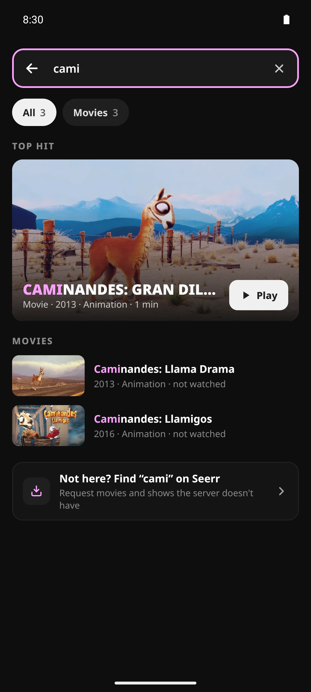
</p>

## Features

### Everywhere

- **A home screen that learns.** Featured titles, Continue watching, Next up, Top 10 this week, Because you
  watched…, genre rows, Latest in each library, Discover, upcoming movies and shows, collections. Each profile's rows
  get reordered over time around the ones they actually play from.
- **Search as you type**, with a best match you can play straight away, results grouped by kind, recent searches and
  genres to browse. Typos are fine.
- **Requests through Seerr** (Jellyseerr and Overseerr work too). Trending, popular and upcoming titles, your own
  requests with their download progress, and everyone's requests for the people allowed to approve them. Requests
  are made as the signed-in person, so their Seerr limits and auto-approval apply. The API key never leaves the
  server.
- **Live TV**: what's on now, a guide grid, channels and recordings. Works with M3U (IPTV) and HDHomeRun tuners and
  XMLTV guides.
- **Skip intro, recap and credits** from Jellyfin's media segments (the [Intro Skipper](https://github.com/intro-skipper/intro-skipper)
  plugin makes them). Each profile picks "Show button", "Skip automatically" or "Off" for each kind.
- **English and French.** "Auto" follows the device, and each profile can choose.

### In the browser

- **The player**: chapters and seek previews on the scrubber, audio and subtitle tracks (styled ASS/SSA and PGS are
  drawn in the browser), Up next, a pause screen, picks at the end of a movie, Watch together (SyncPlay) and casting
  to other Jellyfin apps.
- **An experimental player** (Settings › Playback › Advanced) that decodes HEVC and other formats the browser can't
  play on its own, instead of the server converting them. When the device can't keep up, it hands the video back to
  the server.
- **A play log** behind the Top 10, the viewing history page, row order and genre rows. Jellyfin itself only keeps
  the last play of each title.
- **Personal settings** at `/settings`: profile and sign-in, home screen, playback, subtitles, display (accent,
  language, dates, screensaver, TV layout, custom CSS) and controls.
- **A full admin dashboard** at `/admin` that replaces Jellyfin's: branding, home screen, requests and the play log,
  plus the server itself (settings, users, libraries, playback, networking, Live TV, devices, activity, plugins,
  scheduled tasks, backups with a weekly automatic one, logs and API keys).

### On Android phones and TVs

- **A real TV app**, not the phone app stretched out: a side rail, focus that goes where you expect on a remote, an
  on-screen keyboard grid for search, and voice search when the TV has a speech recognizer.
- **Direct play first.** The app reads what the device can decode, what the screen can show (HDR10, HLG, Dolby
  Vision) and, on TVs, what the receiver can take over HDMI, and asks Jellyfin for exactly that.
- **The player** (AndroidX Media3): chapters, audio and subtitle tracks, subtitle timing, skip buttons and the next
  episode.
- **"Who's watching?"** profiles, several servers, servers found on your network, and Quick Connect, both to sign in
  and to approve another device from the app.
- **Works without the plugin.** On a plain Jellyfin server you get your libraries, search, Live TV and the player.
  When the server has Seedy, the app also shows its home rows and the Requests tab.
- **Settings** for playback, subtitles and the home screen, some per device and some per profile. With the plugin,
  the profile ones are the same as on the web.

## Screenshots

### Web

| | |
|---|---|
| 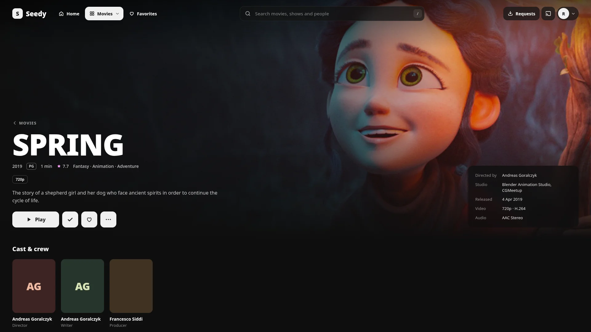 | 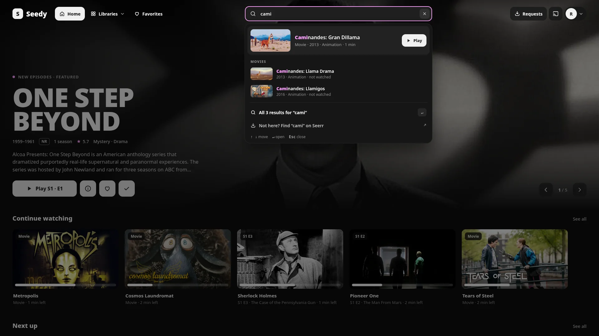 |
| 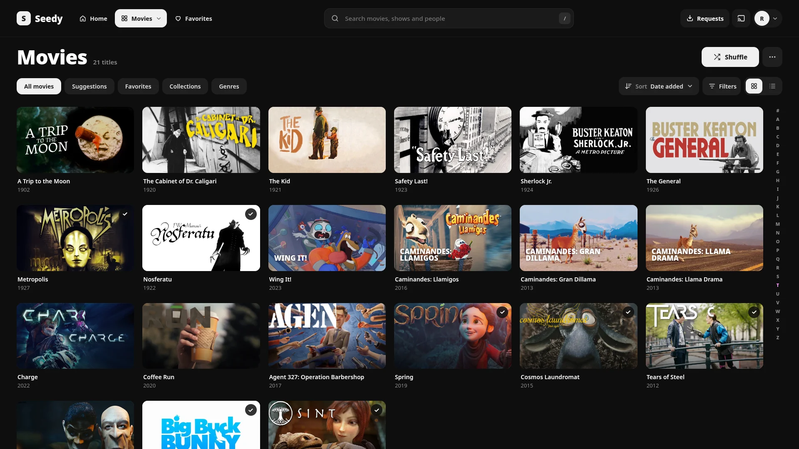 |  |
| 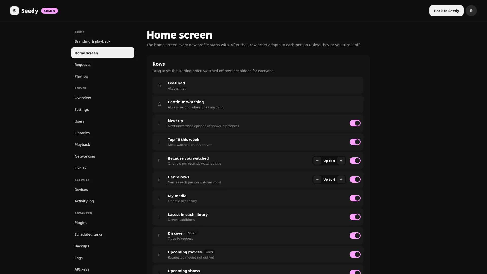 | 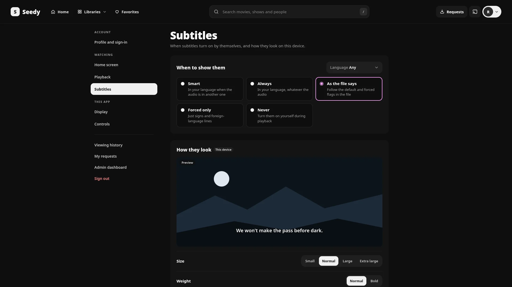 |

### Android TV

| | |
|---|---|
| 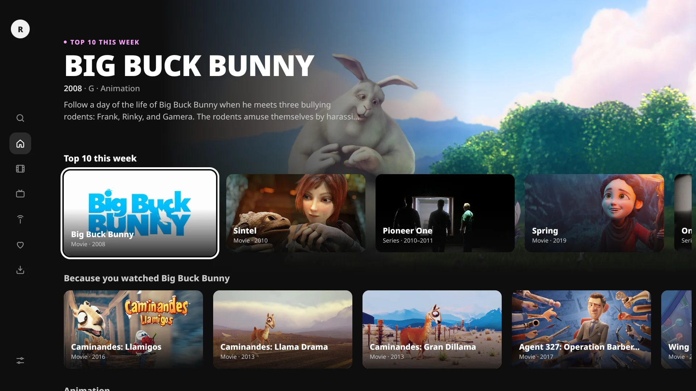 | 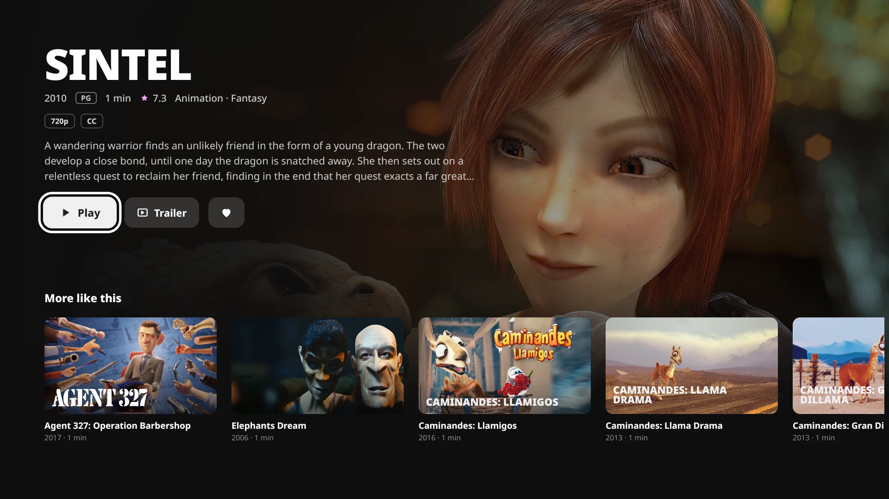 |
| 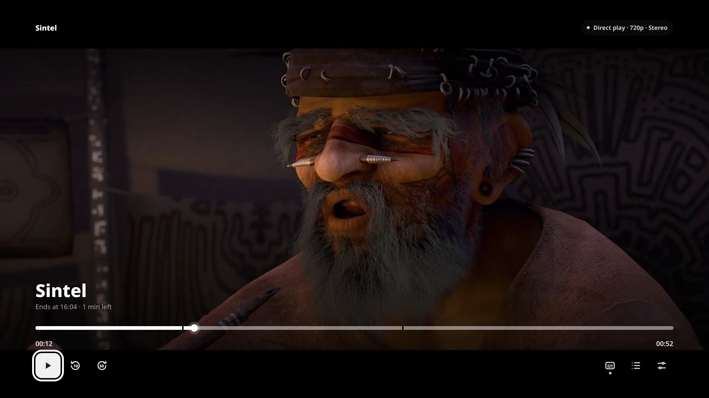 | 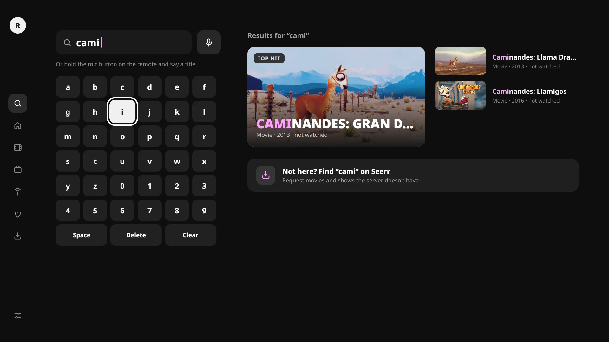 |

The titles are [Blender Studio](https://studio.blender.org/films/) open movies (CC BY) and public-domain films and
shows, with artwork and details from [TMDB](https://www.themoviedb.org).

## Install

### The web app (Jellyfin plugin)

Requires **Jellyfin 12.0 or newer**.

1. In Jellyfin, open **Dashboard › Plugins › Repositories**, add a repository named `Seedy` with this URL, and save:

   ```
   https://arkmind.github.io/seedy/manifest.json
   ```

2. In the **Catalogue**, open **Seedy**, install it, and restart Jellyfin.
3. Open your server's address and sign in. Administrators find Seedy's settings at `/admin`.

New versions show up in Jellyfin's plugin catalogue as updates. Each release's `seedy_<version>.zip` is also on the
[Releases](https://github.com/Arkmind/seedy/releases) page, for installing by hand (see [Build](#build)).

To go back to Jellyfin's web app, uninstall Seedy under **Dashboard › Plugins** (Jellyfin's dashboard stays reachable
at `/old`) and restart Jellyfin.

### The Android app

<p>
  <a href="https://github.com/Arkmind/seedy/releases/latest"></a>
</p>

Google Play is on its way. Until then, every [release](https://github.com/Arkmind/seedy/releases/latest) has a
signed `seedy-android-<version>.apk` (also there zipped). The same file installs on phones, tablets and Android TV /
Google TV. It needs Android 8.0 or newer.

- **On a phone:** open the APK from your downloads and allow your browser to install apps when Android asks.
- **On a TV:** allow the app you'll install it with to install unknown apps (on Google TV: Settings › Apps ›
  Security & restrictions › Unknown sources). Then download the APK with a browser app such as Downloader, copy it
  over with a file manager or "Send files to TV", or install it from a computer:

  ```bash
  adb install seedy-android-<version>.apk
  ```

The app finds Jellyfin servers on your network by itself; otherwise type the server's address. It doesn't update
itself: install a newer APK over the old one.

### Where the web app opens

- Seedy opens at the server address itself (`https://<server>/`, `/admin`, `/settings`…).
- Jellyfin's own web app moves to `/old`. Browser visits to `/web` are sent to Seedy; Jellyfin's Android, Android
  TV, webOS and desktop apps, which embed `/web`, keep working.
- To keep Jellyfin's app at the server address instead, choose **Admin › Branding & playback › Where Seedy opens ›
  Alongside Jellyfin**: Seedy then lives at `/seedy/`.
- Behind a Jellyfin base URL (e.g. `/jellyfin`), Seedy opens at `{base}/`, and `{base}/old` redirects to `{base}/web/`
  because Jellyfin's app can only find its server from a `/web` address.

## Setup

### Seerr

**Admin › Requests.** Enter Seerr's address *as the Jellyfin server reaches it* (for example `http://seerr:5055` on a
Docker network) and its API key (Seerr › Settings › General). Profiles are matched to Seerr accounts automatically when
Seerr uses Jellyfin sign-in; admins can link the others by hand and switch requesting off per profile. Set Seerr's
**Application URL** (Seerr › Settings › General) to an address browsers can open, so the Requests links work.

The Android app goes through the plugin for requests, so there's nothing to set up on the phone or the TV.

### Skip intro and credits

Seedy reads Jellyfin's media segments (`Intro`, `Recap`, `Outro`…). A segment provider such as the
[Intro Skipper](https://github.com/intro-skipper/intro-skipper) plugin creates them. Each profile chooses "Show button",
"Skip automatically" or "Off" per segment type; the admin sets the defaults.

### Live TV

Add a tuner and a guide under **Admin › Live TV** (an M3U playlist for IPTV, or an HDHomeRun), then **Refresh guide
data**. Live TV then appears in the Libraries menu, and in the Android app.

## Compatibility

- **Jellyfin:** the plugin needs 12.0 or newer. The Android app is built and tested against Jellyfin 12, and tells you
  when a server is too old for it.
- **Seerr:** tested with current Seerr releases. Jellyseerr and Overseerr speak the same API. Seerr works best
  when it signs people in with Jellyfin, so their accounts match up on their own.
- **Browsers:** any current browser. The experimental player decodes 4K only when the page can use WebAssembly
  threads; without them it stops at 1080p.
- **Android:** 8.0 and newer, phones, tablets and Android TV / Google TV.

Something doesn't work on your setup? [Open an issue](https://github.com/Arkmind/seedy/issues) with your Jellyfin
version and the device or browser.

## Build

```bash
make build      # or ./build.sh
```

Needs [Bun](https://bun.sh), Python 3, and either the .NET 10 SDK or Docker (it then builds in
`mcr.microsoft.com/dotnet/sdk:10.0`). It typechecks and builds the web app into `src/Jellyfin.Plugin.Seedy/Web`
(embedded in the DLL), publishes the plugin, and writes `artifacts/seedy_<version>.zip` plus a single-release
`artifacts/manifest.json`. The first build downloads the experimental player's WebAssembly decoders from libmedia's
repository (pinned and checked, see `web/vite/libmedia.ts`).

To install a build by hand: stop Jellyfin, copy `Jellyfin.Plugin.Seedy.dll` and `meta.json` from
`artifacts/package/` into `<jellyfin config>/plugins/Seedy_<version>/`, then start Jellyfin again.

For the Android app you need JDK 21 and the Android SDK:

```bash
make android    # debug APK in android/app/build/outputs/apk/debug/
```

## Develop

```bash
make dev-up        # test Jellyfin 12.2 on :8096, Seerr on :5055, Sonarr :8989 (+ :8990 for 4K), Radarr :7878
# open http://localhost:8096 and finish Jellyfin's setup wizard with an admin named Alex, password seedy
# (the dev scripts sign in with it)
make dev-media     # fill the library with open-licensed titles: Blender open movies and public-domain films
make dev-seerr     # connect the test Seerr to the test Jellyfin
make dev-arr       # give Seerr its Sonarr, 4K Sonarr and Radarr (quality profiles, folders, 4K requests)
make dev-install   # build, install into the test server and restart it
make web           # Vite on http://127.0.0.1:5173/seedy/, proxied to the test server
make web-mock      # …or answer /Seedy/* from fixtures (web/dev/mock-plugin.ts)
```

On Android, `make android-test` runs the unit tests and compares every screen with its recorded screenshot
(`make android-shots` records them again). An emulator reaches the test server at `10.0.2.2:8096`. The app shares
the web app's colours, icons and French translations: after changing web French strings, run `make android-shared`
and commit what it changes in `android/`, or the Android CI fails.

`make` lists every target; each one is a short command you can also run by hand (see the [Makefile](Makefile)).
See [CONTRIBUTING.md](CONTRIBUTING.md) for conventions (translations, routes, Jellyfin 12 quirks).

## Layout

```
src/Jellyfin.Plugin.Seedy/
  Plugin.cs, PluginServiceRegistrator.cs
  Configuration/          admin settings (stored as Jellyfin plugin XML) and the dashboard page
  Api/WebController       serves the app's files at /seedy/ (index.html for app routes, immutable caching for assets)
  Api/SeedyController     /Seedy: branding, profile and preferences, home rows, Featured, Top 10, history (/Seedy/Plays)
  Api/RequestsController  /Seedy/Requests: Seerr discover, search, upcoming, details, requests and their approval
  Api/AdminController     /Seedy/Admin: config, status, logo, Seerr connection and accounts, play log
  Api/BackupsController   /Seedy/Admin/BackupFiles and /Seedy/Admin/BackupSchedule
  Api/TrailerController   /Seedy/Items/{id}/Trailer: local, TMDB (Jellyfin metadata) or Seerr trailers
  Services/               home rows and learned order, Seerr, play recorder, preferences, trailers,
                          RootRedirect (Seedy's pages at the server address, Jellyfin's app at /old)
  Data/SeedyDatabase      SQLite (play log, hidden titles, preferences, learned row order) in <data>/seedy/seedy.db
  Tasks/                  play log retention, weekly automatic backup
web/                      Preact + TypeScript + Vite
  src/api                 Jellyfin client, Seedy API contract (seedy.ts), Live TV, image helpers
  src/lib                 app state, router, store, translations, dates and numbers, casting
  src/ui                  design tokens and shared components; the navbar and its search
  src/screens/browse      Home, Details, Library, lists, Favorites, History, Search, Seerr titles
  src/screens/livetv      Live TV: On now, Guide, Channels, Recordings
  src/screens/requests    Requests: Discover, My requests, All requests (Seerr)
  src/screens/me          personal settings (/settings)
  src/screens/admin       Seedy's admin pages and the dashboard shell
  src/screens/server      the server dashboard; its Jellyfin API calls are in api.ts
  src/player              the player (on demand and live), and the experimental player (soft-*.ts)
  vite/libmedia.ts        serves libmedia and its decoders for the experimental player
  src/i18n/fr             French translations
android/                  Kotlin + Jetpack Compose
  core                    Jellyfin SDK, sessions and servers, Seedy API, shared view models, translations
  ui                      theme, text, icons and shared components
  player                  Media3 player, device capabilities and Jellyfin device profile
  mobile                  phone and tablet screens
  tv                      Android TV screens
  app                     the single APK (TV screens on devices with Leanback)
Makefile                  shortcuts for the build and the test server (`make` lists them)
scripts/                  release helper (plugin repository manifest), Android shared files
dev/                      local test server, media generator, Seerr setup
```

## Contributing

Issues and pull requests are welcome. For anything big, open an issue first so we can talk it through before you
spend a weekend on it. [CONTRIBUTING.md](CONTRIBUTING.md) has the conventions.

Seedy speaks English and French. The English text is the key, so on the web a new language is a folder under
`web/src/i18n/` plus one entry in `LANGS`.

## Credits

Seedy builds on [Jellyfin](https://jellyfin.org) and talks to [Seerr](https://github.com/seerr-team/seerr)
(Jellyseerr / Overseerr), and wouldn't exist without either.

The web app uses [Preact](https://preactjs.com) (MIT), [hls.js](https://github.com/video-dev/hls.js) (Apache-2.0),
[libmedia](https://github.com/zhaohappy/libmedia) (LGPL-3.0-or-later, with decoders from FFmpeg) for the experimental
player, and the [Noto Sans](https://fonts.google.com/noto) fonts (SIL Open Font License).

The Android app uses the [Jellyfin Kotlin SDK](https://github.com/jellyfin/jellyfin-sdk-kotlin) (LGPL-3.0),
[Jetpack Compose](https://developer.android.com/compose) and Compose for TV,
[AndroidX Media3](https://github.com/androidx/media) and [Coil](https://github.com/coil-kt/coil) (all Apache-2.0).

## Disclaimer

Seedy doesn't come with any content. It plays what's on your own Jellyfin server and isn't meant for piracy. It's an
independent project, not affiliated with or endorsed by the Jellyfin project.

## License

[GNU General Public License v3.0 or later](LICENSE).
