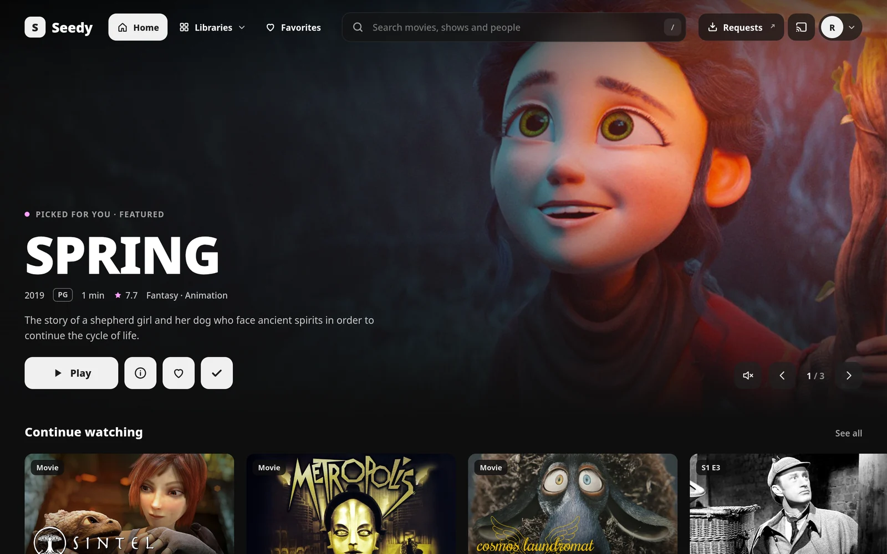
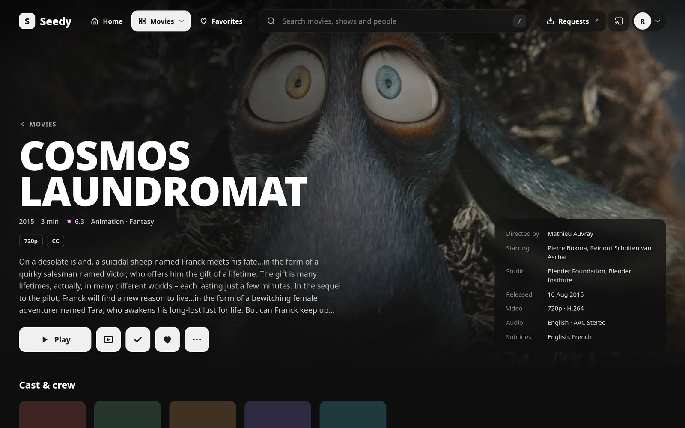
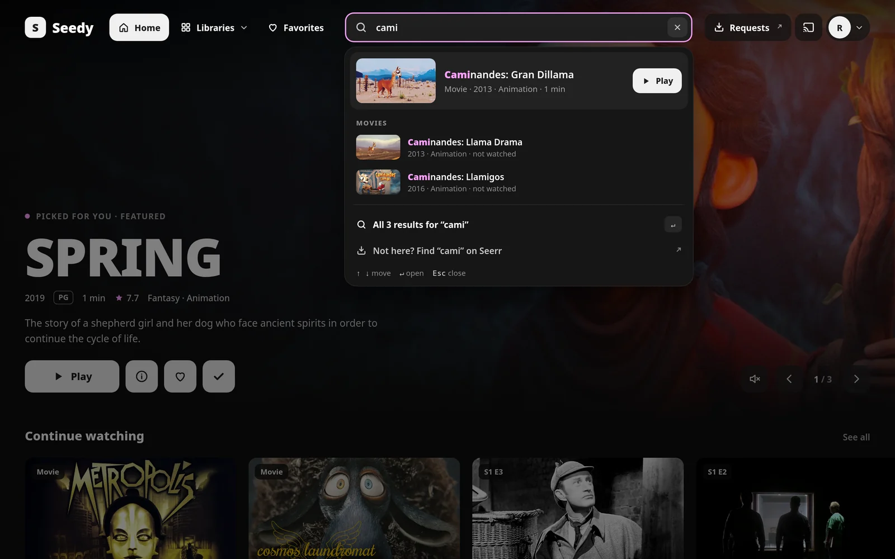
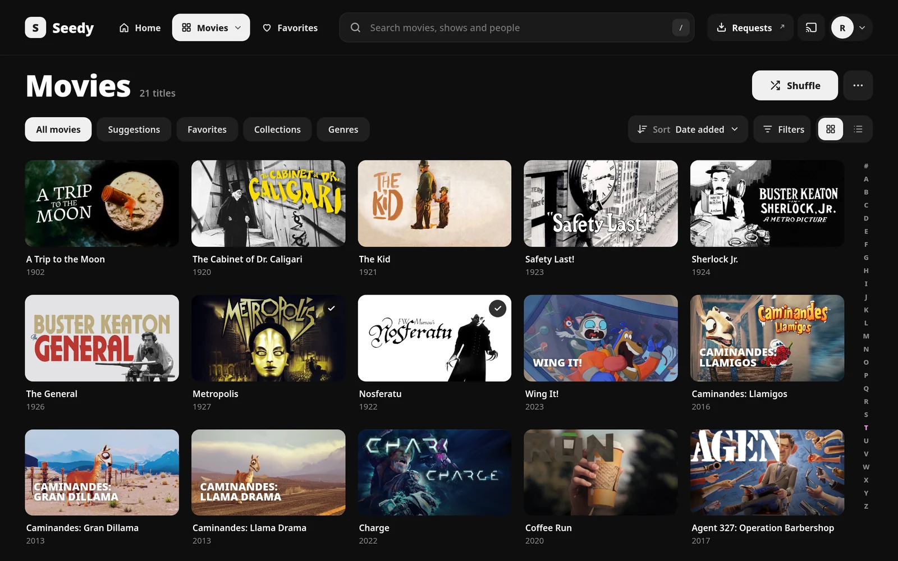
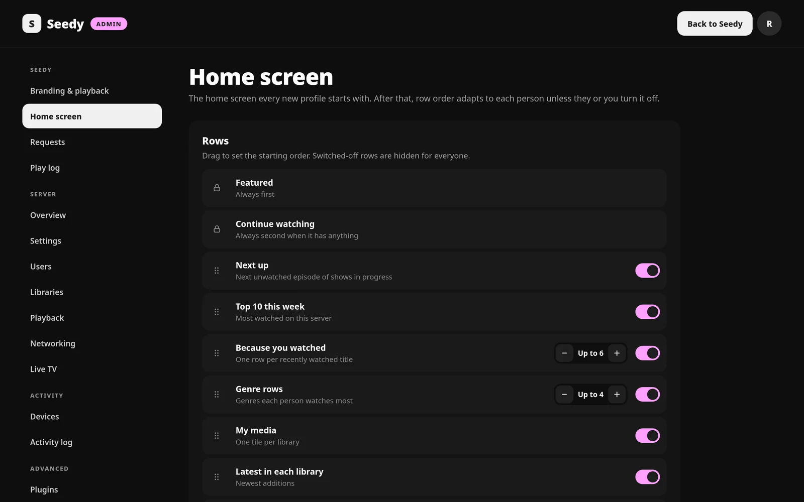
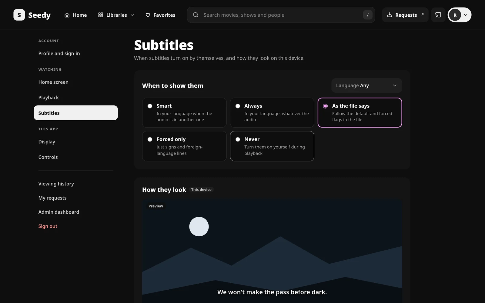

# Seedy for Jellyfin



Seedy is a new web app for [Jellyfin](https://jellyfin.org) 12, shipped as a single Jellyfin plugin. Install it from a
plugin repository and the server address opens Seedy instead of Jellyfin's web app.

- **A home screen that learns.** Featured titles with muted trailers, Continue watching, Next up, Top 10 this week,
  Because you watched…, genre rows, My media, Latest in each library, Discover, Upcoming movies and shows, and
  Collections. Each profile's row order adapts to the rows they actually play from.
- **Search as you type.** Results grouped by kind with a best match you can play straight away, recent searches,
  browse by genre, typo-tolerant matching. "Not what you're searching for? Request it" under the results.
- **Requests through Seerr** (Jellyseerr / Overseerr). A Requests page with Seerr's trending, popular and upcoming
  titles, your requests and their download progress, and everyone's requests to approve or decline for request managers.
  Requests are made as the signed-in person, so their Seerr limits and auto-approval apply. The API key never leaves
  the server.
- **Live TV.** On now, a guide grid with a "now" line, channels, recordings and series rules, and a live player with
  channel up/down, last channel and a channel list. Works with M3U (IPTV) and HDHomeRun tuners and XMLTV guides.
- **A player.** Skip intro, recap and credits from media segments (works with the Intro Skipper plugin), chapters and
  seek previews on the scrubber, audio and subtitle tracks (styled ASS/SSA and PGS drawn in the browser), Up next,
  pause screen, end-of-movie picks, Watch together (SyncPlay), cast to other Jellyfin apps.
- **A play log.** It feeds the Top 10, the viewing history page, row order and genre rows. Jellyfin itself only keeps
  the last play of each title.
- **Personal settings** at `/settings`: profile and sign-in, home screen, playback, subtitles, display (accent,
  language, dates, screensaver, TV layout, custom CSS) and controls.
- **A complete admin dashboard** at `/admin`, replacing Jellyfin's: branding, home screen, requests and play log;
  server overview, settings, users, libraries, playback, networking and Live TV; devices and activity log; plugins,
  scheduled tasks, backups (including a weekly automatic backup), logs and API keys.
- **English and French.** "Auto" follows the browser; each profile can choose.

## Screenshots

| | |
|---|---|
|  |  |
|  |  |
|  |  |

The titles are [Blender Studio](https://studio.blender.org/films/) open movies (CC BY) and public-domain films, with
artwork and details from [TMDB](https://www.themoviedb.org).

## Install

Requires **Jellyfin 12.0 or newer**.

1. In Jellyfin, open **Dashboard › Plugins › Repositories**, add a repository named `Seedy` with this URL, and save:

   ```
   https://arkmind.github.io/seedy/manifest.json
   ```

2. In the **Catalogue**, open **Seedy**, install it, and restart Jellyfin.
3. Open your server's address and sign in. Administrators find Seedy's settings at `/admin`.

New releases show up in Jellyfin's plugin catalogue as updates. Each release's `seedy_<version>.zip` is also on the
[Releases](https://github.com/Arkmind/seedy/releases) page, for installing by hand (see [Build](#build)).

To go back to Jellyfin's web app, uninstall Seedy under **Dashboard › Plugins** (Jellyfin's dashboard stays reachable
at `/old`) and restart Jellyfin.

### Where things open

- Seedy opens at the server address itself (`https://<server>/`, `/admin`, `/settings`…).
- Jellyfin's own web app moves to `/old`. Browser visits to `/web` are sent to Seedy; Jellyfin's Android, Android
  TV, webOS and desktop apps, which embed `/web`, keep working.
- To keep Jellyfin's app at the server address instead, choose **Admin › Branding & playback › Where Seedy opens ›
  Alongside Jellyfin**: Seedy then lives at `/seedy/`.
- Behind a Jellyfin base URL (e.g. `/jellyfin`), Seedy opens at `{base}/`, and `{base}/old` redirects to `{base}/web/`
  because Jellyfin's app can only find its server from a `/web` address.

## Setup

### Seerr

**Admin › Requests.** Enter Seerr's address *as the Jellyfin server reaches it* (for example `http://seerr:5055` on a
Docker network) and its API key (Seerr › Settings › General). Profiles are matched to Seerr accounts automatically when
Seerr uses Jellyfin sign-in; admins can link the others by hand and switch requesting off per profile. Set Seerr's
**Application URL** (Seerr › Settings › General) to an address browsers can open, so the Requests links work.

### Skip intro and credits

Seedy reads Jellyfin's media segments (`Intro`, `Recap`, `Outro`…). A segment provider such as the
[Intro Skipper](https://github.com/intro-skipper/intro-skipper) plugin creates them. Each profile chooses "Show button",
"Skip automatically" or "Off" per segment type; the admin sets the defaults.

### Live TV

Add a tuner and a guide under **Admin › Live TV** (an M3U playlist for IPTV, or an HDHomeRun), then **Refresh guide
data**. Live TV then appears in the Libraries menu.

## Build

```bash
make build      # or ./build.sh
```

Needs [Bun](https://bun.sh), Python 3, and either the .NET 10 SDK or Docker (it then builds in
`mcr.microsoft.com/dotnet/sdk:10.0`). It typechecks and builds the web app into `src/Jellyfin.Plugin.Seedy/Web`
(embedded in the DLL), publishes the plugin, and writes `artifacts/seedy_<version>.zip` plus a single-release
`artifacts/manifest.json`.

To install a build by hand: stop Jellyfin, copy `Jellyfin.Plugin.Seedy.dll` and `meta.json` from
`artifacts/package/` into `<jellyfin config>/plugins/Seedy_<version>/`, then start Jellyfin again.

## Develop

```bash
make dev-up        # test Jellyfin 12.2 on :8096, Seerr on :5055, Sonarr :8989 (+ :8990 for 4K), Radarr :7878
# open http://localhost:8096 and finish Jellyfin's setup wizard with an admin named Alex, password seedy
# (the dev scripts sign in with it)
make dev-media     # fill the library with open-licensed titles: Blender open movies and public-domain films
make dev-seerr     # connect the test Seerr to the test Jellyfin
make dev-arr       # give Seerr its Sonarr, 4K Sonarr and Radarr (quality profiles, folders, 4K requests)
make dev-install   # build, install into the test server and restart it
make web           # Vite on http://127.0.0.1:5173/seedy/, proxied to the test server
make web-mock      # …or answer /Seedy/* from fixtures (web/dev/mock-plugin.ts)
```

`make` lists every target; each one is a short command you can also run by hand (see the [Makefile](Makefile)).
See [CONTRIBUTING.md](CONTRIBUTING.md) for conventions (translations, routes, Jellyfin 12 quirks).

## Layout

```
src/Jellyfin.Plugin.Seedy/
  Plugin.cs, PluginServiceRegistrator.cs
  Configuration/          admin settings (stored as Jellyfin plugin XML) and the dashboard page
  Api/WebController       serves the app's files at /seedy/ (index.html for app routes, immutable caching for assets)
  Api/SeedyController     /Seedy: branding, profile and preferences, home rows, Featured, Top 10, history (/Seedy/Plays)
  Api/RequestsController  /Seedy/Requests: Seerr discover, search, upcoming, details, requests and their approval
  Api/AdminController     /Seedy/Admin: config, status, logo, Seerr connection and accounts, play log
  Api/BackupsController   /Seedy/Admin/BackupFiles and /Seedy/Admin/BackupSchedule
  Api/TrailerController   /Seedy/Items/{id}/Trailer: local, TMDB (Jellyfin metadata) or Seerr trailers
  Services/               home rows and learned order, Seerr, play recorder, preferences, trailers,
                          RootRedirect (Seedy's pages at the server address, Jellyfin's app at /old)
  Data/SeedyDatabase      SQLite (play log, hidden titles, preferences, learned row order) in <data>/seedy/seedy.db
  Tasks/                  play log retention, weekly automatic backup
web/                      Preact + TypeScript + Vite
  src/api                 Jellyfin client, Seedy API contract (seedy.ts), Live TV, image helpers
  src/lib                 app state, router, store, translations, dates and numbers, casting
  src/ui                  design tokens and shared components; the navbar and its search
  src/screens/browse      Home, Details, Library, lists, Favorites, History, Search, Seerr titles
  src/screens/livetv      Live TV: On now, Guide, Channels, Recordings
  src/screens/requests    Requests: Discover, My requests, All requests (Seerr)
  src/screens/me          personal settings (/settings)
  src/screens/admin       Seedy's admin pages and the dashboard shell
  src/screens/server      the server dashboard; its Jellyfin API calls are in api.ts
  src/player              the player (on demand and live)
  src/i18n/fr             French translations
Makefile                  shortcuts for the build and the test server (`make` lists them)
scripts/                  release helper (plugin repository manifest)
dev/                      local test server, media generator, Seerr setup
```

## Credits

Seedy builds on [Jellyfin](https://jellyfin.org) and talks to [Seerr](https://github.com/seerr-team/seerr)
(Jellyseerr / Overseerr). The web app uses [Preact](https://preactjs.com) (MIT), [hls.js](https://github.com/video-dev/hls.js)
(Apache-2.0) and the [Noto Sans](https://fonts.google.com/noto) fonts (SIL Open Font License).

Seedy is an independent project, not affiliated with or endorsed by the Jellyfin project.

## License

[GNU General Public License v3.0 or later](LICENSE).
